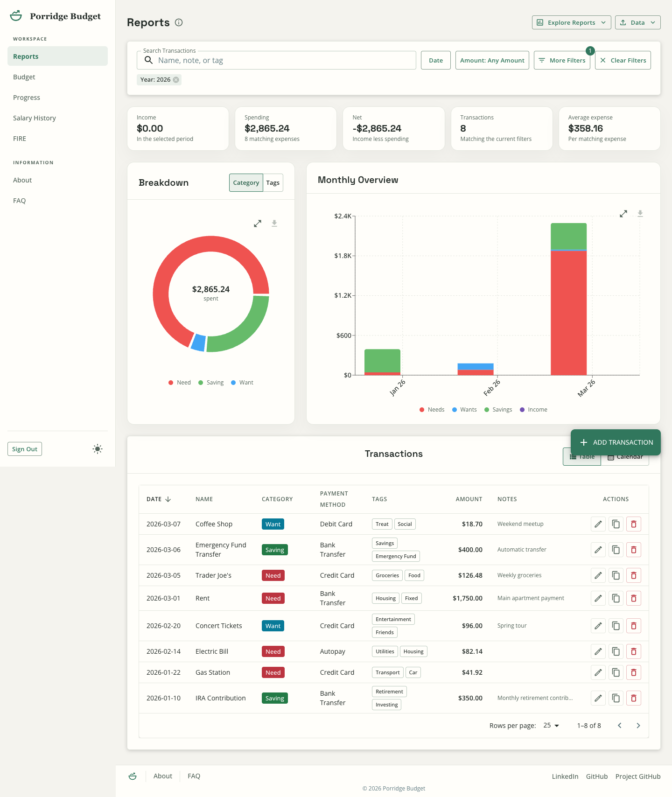
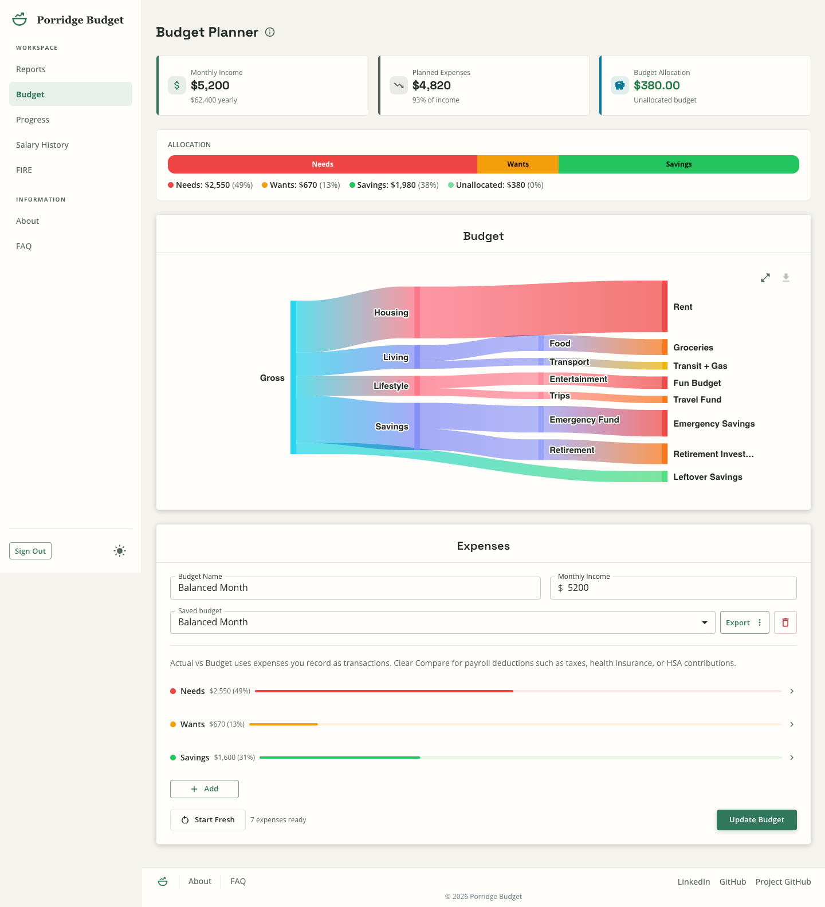
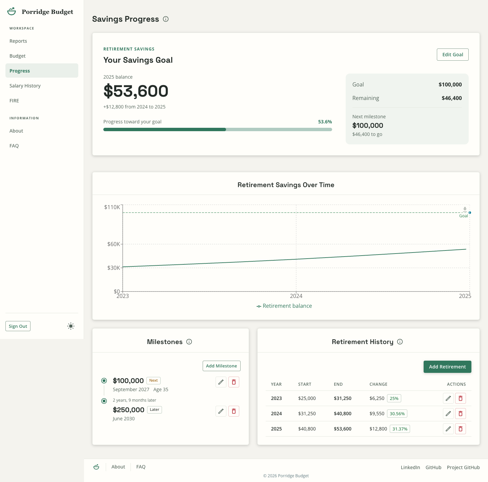
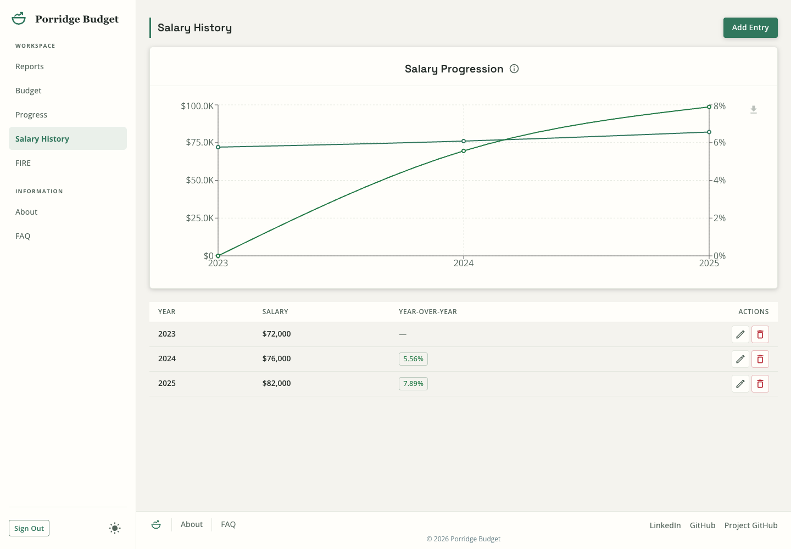
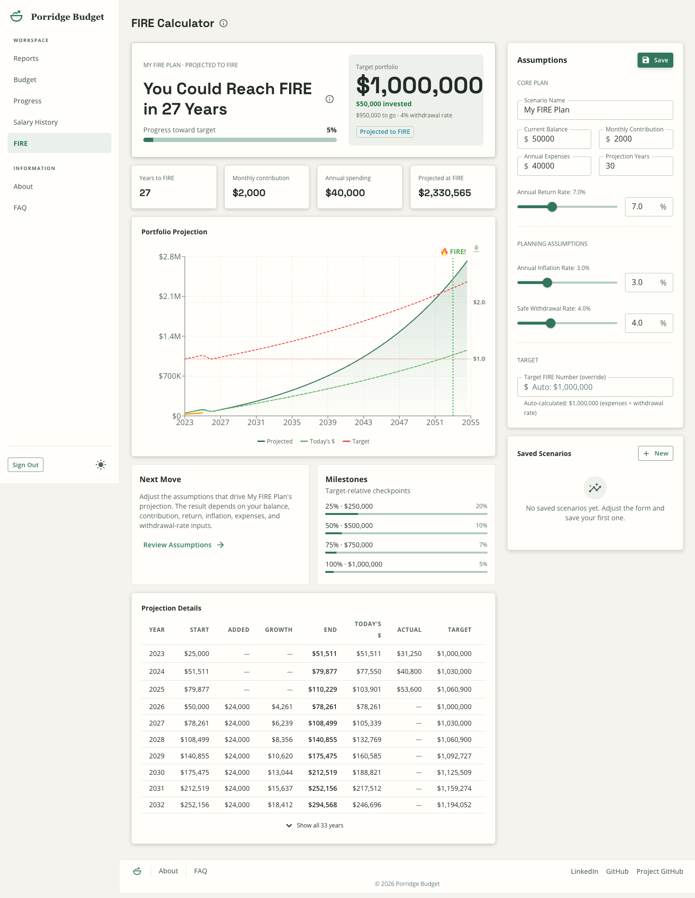

# Porridge Budget

Porridge Budget is a personal budgeting application built with TypeScript, Next.js, and serverless backends. The app helps track income, expenses, budgets, long-term progress, and investment planning with CSV import/export, month- and year-over-year comparisons, and interactive charts that can be downloaded as PNG images.

## Screenshots

The screenshots below show the current desktop workspace in Light mode with seeded demo data. See [Screenshot capture](docs/screenshots/README.md) to refresh them.

### Reports

Review spending by category and tag, compare monthly totals, and manage transactions in one view.



### Budget Planner

Build a monthly budget, compare planned spending with recorded activity, and inspect the budget flow.



### Savings Progress

Track your retirement savings goal, milestones, and retirement account balances over time.



### Salary History

Record salary changes and review year-over-year growth on a dedicated page.



### FIRE Calculator

Explore investment projections and the savings needed for financial independence.



## Tech Stack

- **Frontend:** Next.js (React) with TypeScript
- **UI:** Material-UI (MUI)
- **Charts:** Recharts (time-series/pie) and @nivo/sankey
- **Backend:** Next.js App Router route handlers backed by AWS services
- **Persistence:** DynamoDB application-data table with typed helpers and a separate user-profile table
- **Authentication:** AWS Cognito
- **Email:** AWS SES for the contact form
- **Validation & testing:** Zod + Vitest

## Pages

The signed-in workspace uses a desktop sidebar and a mobile navigation drawer. The brand links to the public home page.

- `/` is the public landing page.
- `/about` includes the app background and contact form. There is no standalone `/contact` page.
- `/faq` answers common questions about the app.
- `/reports` has income and spending summaries, a Category/Tags breakdown toggle, a monthly overview, and Table/Calendar transaction views. Search by name, note, or tag. Date and amount presets sit beside More Filters for custom ranges, categories, included tags, and excluded tags. Excluded tags take precedence over included tags. Use Data for CSV import and filtered export, and Explore Reports for Actual vs Budget, Yearly Report, Compare Months, and Compare Years. Deleted transactions can be restored from the undo notification.
- `/budget` edits monthly income and named expense rows, manages saved budgets, exports the active budget, and displays a Sankey flow. Flow Path accepts `>`-separated groups; the expense name forms the final leaf. Each row's Compare checkbox controls whether its planned amount appears in Actual vs Budget, without removing it from the budget or flow. The comparison month is independent of the saved budget selection.
- `/progress` is Savings Progress, with a retirement savings goal, latest balance and progress summary, retirement trend chart, milestones, and retirement history. Goal and milestone entry use dialogs.
- `/salary` is Salary History, with salary entries, year-over-year comparisons, and a downloadable chart.
- `/fire` projects investment growth and financial independence, with saved scenarios, inflation assumptions, a projection chart, and a yearly breakdown. Scenario persistence requires authenticated backend access; browser demo mode does not implement the FIRE scenario API.
- `/auth/login` offers Sign In, Create Account through Cognito, and Continue with Demo.

Appearance is available from the navigation on every page. Choose Light, Dark,
or System; the choice is saved locally and System follows the device setting.

## APIs

- `GET /api/reports` - (Authenticated) Returns the current user's filtered transactions and aggregates. Supports `pageSize` (up to 200), `cursor`, `years`, `startDate`, `endDate`, `allHistory`, `categories`, `tags`, `excludedTags`, `search`, `minAmount`, `maxAmount`, and `includeAggregates`. Amount bounds are inclusive whole dollars from 0 through 999,999. Dates default to the current calendar year unless years or custom boundaries are supplied. Follow `nextCursor` while `hasMore` is true; `page` numbers above 1 require a cursor. `totalCount` and aggregates describe the filtered cursor page, not the entire date range.
- `POST /api/reports/import` - (Authenticated) Accepts `text/csv` or `{ csv }` JSON payloads and imports rows into the signed-in user's account only. Supports both the expense schema (`Name,Amount,Category,Date,Notes,Payment Method,Tags`) and the income schema (`Source,Amount,Pay Date`).
- `GET /api/reports/export` - (Authenticated) Exports only the signed-in user's filtered transactions as CSV.
- `GET /api/transactions` - (Authenticated) Lists transactions for the current user with optional `startDate`, `endDate`, `limit` (up to 200; `pageSize` is an alias), and `cursor`. Follow `nextCursor` while `hasMore` is true.
- `POST /api/transactions` - (Authenticated) Creates a transaction for the current user.
- `PUT /api/transactions` - (Authenticated) Updates a transaction for the current user.
- `DELETE /api/transactions` - (Authenticated) Deletes a transaction for the current user when `id` and `date` are supplied, returning the deleted public record when one existed.
- `POST /api/transactions/restore` - (Authenticated) Restores a previously deleted transaction with a conditional create; an identical retry is idempotent and conflicting content is rejected.
- `GET /api/budgets` - (Authenticated) List saved budgets for the current user, including monthly income and expense rows when available.
- `POST /api/budgets` - (Authenticated) Create a budget (Zod-validated request payload) with monthly income, expense rows, and legacy allocation compatibility.
- `GET /api/budgets/:id`, `PUT /api/budgets/:id`, `DELETE /api/budgets/:id` - (Authenticated) Fetch, update, or delete a saved budget by id.
- `POST /api/sankey` - Accepts allocation payload and returns `sankeyData` (nodes/links) and `budgetSuggestion`; this is a standalone backend utility. The current Budget Planner builds its flow locally.
- `GET /api/salary`, `POST /api/salary`, `PUT /api/salary`, `DELETE /api/salary` - (Authenticated) Salary history CRUD with server-computed YoY values on reads.
- `GET /api/progress/goal`, `POST /api/progress/goal`, `PUT /api/progress/goal` - (Authenticated) Long-term progress goal CRUD with derived progress fields.
- `GET /api/progress/retirement`, `POST /api/progress/retirement`, `PUT /api/progress/retirement`, `DELETE /api/progress/retirement` - (Authenticated) Retirement-history CRUD with derived change metrics.
- `GET /api/progress/milestones`, `POST /api/progress/milestones`, `DELETE /api/progress/milestones` - (Authenticated) Milestone CRUD for long-term savings checkpoints.
- `GET /api/fire`, `POST /api/fire`, `PUT /api/fire`, `DELETE /api/fire` - (Authenticated) List, create, update, or delete saved FIRE scenarios. Updates and deletes identify a scenario with `scenarioId`.
- `POST /api/contact` - Sends public contact-form submissions through SES.

### Auth / Environment

The app uses AWS Cognito for authentication. Set the following env vars in `.env.local` (see `env.example` for an example):

```
NEXT_PUBLIC_COGNITO_DOMAIN=https://your-domain.auth.us-east-1.amazoncognito.com
NEXT_PUBLIC_COGNITO_CLIENT_ID=<cognito_app_client_id>
NEXT_PUBLIC_COGNITO_USER_POOL_ID=<cognito_user_pool_id>
COGNITO_CLIENT_ID=<cognito_app_client_id>
COGNITO_USER_POOL_ID=<cognito_user_pool_id>
DYNAMODB_TABLE=<transactions_table_name>
DYNAMODB_USERS_TABLE=<users_table_name>
AWS_REGION=us-east-1
NEXT_PUBLIC_GA_ID=<ga4_measurement_id>
NEXT_PUBLIC_SITE_URL=https://porridge-budgeting.vercel.app
CONTACT_SES_FROM_EMAIL=no-reply@example.com
CONTACT_SES_TO_EMAIL=hello@example.com
GOOGLE_SITE_VERIFICATION=<search_console_verification_token>
```

Set `DISABLE_AUTH=true` and `NEXT_PUBLIC_DISABLE_AUTH=true` only when you intentionally want the local demo user and sample CSV dataset; the server-side flag selects demo data and the public flag skips the client-side login redirect. In normal authenticated mode, all report, import, export, and transaction APIs are scoped to the Cognito `sub` and will not fall back to shared sample data for signed-in users.

Google Analytics is optional, but when `NEXT_PUBLIC_GA_ID` is configured the
app now chooses a safe cookie scope for the current host. Visits on the
canonical site from `NEXT_PUBLIC_SITE_URL` share one first-party GA cookie,
while localhost and preview hosts fall back to host-local cookies so realtime
testing still works without invalid-domain cookie warnings. The layout
bootstrap also sends the first `page_view` manually and App Router navigations
queue their own `page_view` until GA is ready, which keeps authenticated
destinations like `/reports`, `/budget`, and `/progress` reporting their
individual page titles instead of collapsing into the default app title.

To explore the UI without AWS credentials, open `/auth/login` and choose
`Continue with Demo`. This seeds browser-local data for reports, budgets, salary,
and savings progress. Demo edits remain in local storage across refreshes until
sign-out or a new demo session. The demo session flag is tab-local. This flow
does not authorize direct HTTP requests to protected APIs.

Real hosted sign-in sessions persist across browser restarts until the user signs
out or Cognito expires/revokes the refresh token, so reopening the app should not
require a fresh login in the normal case.

## Getting Started

1. Clone the repo and install dependencies:
   ```bash
   pnpm install
   ```
2. Run the development server:
   ```bash
   pnpm run dev
   ```
3. Open http://localhost:3000/auth/login and choose Continue with Demo, or configure Cognito and sign in.
   - Reports: http://localhost:3000/reports
   - Budget Planner: http://localhost:3000/budget
   - Savings Progress: http://localhost:3000/progress
   - Example API requests (send a Cognito access token as `Authorization: Bearer <access_token>` for protected routes):
     - `GET http://localhost:3000/api/reports?pageSize=5`
     - `POST http://localhost:3000/api/sankey` (see `app/api/sankey/route.ts` for the allocation payload shape)

## Quality Checks

- `pnpm lint` - ESLint checks through `next lint`. This passes on the current Next.js 15 release, but the command is deprecated and needs migration to the standalone ESLint CLI before upgrading to Next.js 16.
- `pnpm test --run` - Vitest suite
- `pnpm build` - production build verification

## Notes

- All authenticated report, import, export, budget, salary, progress, and transaction APIs are scoped to the signed-in Cognito user. Continue with Demo uses browser-local sample data. The server-side `DISABLE_AUTH` flag is a separate development bypass and is not a browser demo session.
- The reports page includes monthly comparison plus like-for-like yearly comparison: historical years use full calendars, while selections involving the current year use matched year-to-date cutoffs.
- The Vitest suite covers route handlers, shared utilities, UI contracts, auth helpers, DynamoDB behavior, and CSV edge cases. Run `pnpm test --run` for current totals.
- Public pages ship shared metadata, Open Graph/Twitter tags, `robots.txt`, `sitemap.xml`, and JSON-LD on the home and FAQ routes.
- The MUI date pickers use `AdapterDateFnsV3` (date-fns v3) - ensure compatibility when upgrading dependencies.
- Candidate product ideas are tracked in `docs/future-feature-ideas.md`.

## Contributing

This is a personal project; contributions and suggestions are welcome. Keep documentation and screenshots in sync with user-visible changes. See [candidate product ideas](docs/future-feature-ideas.md) for exploratory work.

## Acknowledgements

A significant portion of this project's code, documentation, and tests were produced with the assistance of GitHub Copilot while exploring how to use Copilot to build a real application. Copilot suggested scaffolding, implementation snippets, and documentation which were reviewed and adapted by the author. All generated content has been manually reviewed; please verify behavior and security if reusing or contributing. Avoid committing secrets or credentials; treat AI-assisted code as guidance that requires human validation.
